# 探店汇 · 高并发社区点评平台

> 基于 Spring Boot + MyBatis-Plus + Redis + RocketMQ 的社区点评后端项目，重点演练 **Redis 在高并发场景下的深度应用**：缓存三大问题、分布式锁、秒杀全链路优化、多级缓存、接口限流与消息可靠性。

---

## 📋 项目简介

探店汇是一个类似大众点评的社区点评平台，用户可以浏览商铺、发布探店笔记、参与优惠券秒杀。项目以 **Redis 高并发实战** 为核心目标，系统性解决以下典型问题：

- 热点商铺访问量大 → Redis 缓存 + 穿透/击穿/雪崩三套方案
- 秒杀超卖与一人一单 → Lua 原子预扣 + RocketMQ 事务消息异步削峰
- 集群 Session 不共享 → Redis 替代 Session + Token + 双拦截器滑动过期
- 高频接口刷单 → Redis ZSet 滑动窗口限流 + Prometheus 可观测

---

## 🛠 技术栈

| 分类 | 技术 | 版本 | 说明 |
|------|------|------|------|
| 后端框架 | Spring Boot | 2.7.18 | 核心开发框架（JDK 17） |
| 持久层 | MyBatis-Plus | 3.5.3.1 | 通用 CRUD + 分页插件 |
| 数据库 | MySQL | 8.0 | 关系型数据库 |
| 缓存中间件 | Redis | 7.x | 缓存 / 锁 / 计数器 / 限流（`redis:7-alpine`） |
| 分布式锁 | Redisson | 3.23.5 | 可重入锁 + 看门狗续期 |
| 本地缓存 | Caffeine | 2.9.3 | 多级缓存 L1，热点 Key 进程内缓存 |
| 消息队列 | RocketMQ | 4.9.7 | 事务消息（半消息 + 本地事务 + 回查），客户端 starter 2.2.3 |
| 脚本 | Lua | - | Redis 原子操作（预扣库存 / 滑动窗口限流） |
| 可观测 | Actuator + Micrometer + Prometheus | - | 业务指标与 JVM 指标暴露 |
| CI | GitHub Actions | - | 编译 + 打包 + 镜像构建校验 |
| 工具库 | Hutool / Lombok / Maven | - | 工具类、代码简化、构建 |

---

## 🏗 项目架构

```
┌──────────────┐   HTTP    ┌─────────────┐          ┌──────────┐
│ 客户端       │ ─────────▶│ Spring Boot │ ────────▶│  MySQL   │
│ (Postman/H5) │ ◀─────────│  后端服务   │          └──────────┘
└──────────────┘           └─────────────┘          ┌──────────┐
                           │        └──────────────▶│  Redis   │
                           │                        └──────────┘
                           │
                           ├─ CacheClient：缓存三大问题通用封装
                           ├─ Caffeine：本地缓存（L1）
                           ├─ Redisson：分布式锁
                           ├─ RocketMQ：事务消息异步下单
                           └─ @RateLimit + Lua：接口限流
```

**Redis 在项目中承担的角色：**

| 角色 | 场景 | 数据结构 |
|------|------|----------|
| 缓存层 | 商铺数据缓存（防穿透/击穿/雪崩） | String（JSON） |
| 会话层 | 登录 Token + 用户信息（替代 Session） | Hash |
| 分布式锁 | 秒杀一人一单、缓存击穿互斥锁 | String / Redisson |
| 预扣库存 | 库存判断 + 一人一单原子预扣 | Lua + String + Set |
| 接口限流 | 滑动窗口限流（防刷） | ZSet |

---

## 📂 项目结构

```
shop-review/
├── src/main/java/com/hmdp/
│   ├── annotation/RateLimit.java          # 限流注解（窗口/阈值/维度）
│   ├── aspect/RateLimitAspect.java        # 限流切面（429 + Retry-After）
│   ├── config/                            # MvcConfig（双拦截器）、RedissonConfig、
│   │                                      # MybatisConfig、LocalCacheConfig（Caffeine）、WebExceptionAdvice
│   ├── controller/                        # 9 个 Controller
│   ├── dto/  entity/  mapper/             # 传输对象 / 11 个实体 / MyBatis-Plus Mapper
│   ├── exception/RateLimitException.java
│   ├── job/SeckillReconcileJob.java       # 定时对账（Redis vs DB）
│   ├── metrics/BusinessMetrics.java       # Micrometer 业务指标
│   ├── mq/                                # 生产者、事务监听器、消费者、消息体
│   ├── service/                           # 业务接口 + impl
│   └── utils/                             # CacheClient、RedisIdWorker、分布式锁、双拦截器、Key 常量
├── src/main/resources/
│   ├── db/hmdp.sql                        # 建表 + 基础数据
│   ├── db/plan_b_rocketmq.sql             # 幂等唯一索引 + 消息消费日志表
│   ├── lua/seckill_mq.lua                 # 库存判断 + 一人一单 + 预扣（原子）
│   ├── lua/rate_limit.lua                 # ZSet 滑动窗口限流
│   ├── unlock.lua                         # 分布式锁释放
│   ├── mapper/VoucherMapper.xml
│   └── application.yaml
├── jmeter/                                # seckill.jmx、shop-read.jmx、tokens.csv
├── scripts/                               # gen-loadtest-tokens.sh、reset-seckill.sh、measure-drain.sh
├── rocketmq/broker.conf                   # Broker 配置（brokerIP1 / 存储路径）
├── .github/workflows/ci.yml                # CI：compile → package → docker build
├── Dockerfile / Dockerfile.mysql / docker-compose.yml
└── pom.xml
```

---

## 💡 核心功能与技术亮点

### 1. 短信登录：Redis 替代 Session + 双拦截器滑动过期

传统 Session 在集群下无法共享，请求打到不同节点就登录失效。改为：

- **验证码**：`login:code:{phone}`，String 结构，2 分钟 TTL
- **Token**：登录成功生成 UUID Token，用户信息以 Hash 存入 Redis，30 分钟过期
- **双拦截器**：`RefreshTokenInterceptor`（外层，所有请求，读 Redis 写 ThreadLocal 并续期）+ `LoginInterceptor`（内层，只拦需登录接口，判断 ThreadLocal）
- **滑动过期**：每次活跃请求刷新 TTL，离线超 30 分钟自然失效

核心代码：`utils/RefreshTokenInterceptor.java`、`utils/LoginInterceptor.java`、`config/MvcConfig.java`

---

### 2. 商铺缓存：三大问题 + CacheClient 封装 + 多级缓存

| 问题 | 产生原因 | 解决方案 | 对应方法 |
|------|----------|----------|----------|
| **穿透** | 查询不存在的数据，缓存和 DB 都没有 | 空值缓存（短 TTL 防脏数据） | `queryWithPassThrough` |
| **击穿** | 热点 Key 过期瞬间，大量并发打 DB | 互斥锁（SETNX）+ 重试等待 | `queryWithMutex` |
| **击穿（不阻塞）** | 同上，但要求不阻塞用户线程 | 逻辑过期 + 异步线程重建 | `queryWithLogicalExpire` |
| **雪崩** | 大量 Key 同时过期 | 逻辑过期天然避免 / TTL 随机化 | 同上 |

**封装亮点**：泛型 + `Function` 函数式入参，业务只传查询逻辑；内置 10 线程池用于逻辑过期异步重建；三种策略按场景切换。

**多级缓存（L1 Caffeine + L2 Redis）**：链路 `Caffeine → Redis → MySQL`，Redis 命中后回填 L1；容量 1000、TTL 5s 由 `shop.local-cache.*` 配置，命中统计经 Micrometer 暴露为 `cache_gets_total{cache="shopLocalCache"}`。

**缓存一致性：延迟双删**

- 写路径：事务 `afterCommit` 后删本地缓存 + Redis，再调度 500ms 后二次删除
- 为什么提交后才删：事务未提交时删，并发读会立刻回源旧值写回缓存，等于白删
- 为什么要双删：清理"读回源旧值 → 写回缓存"这个小窗口的脏数据
- 多实例取舍：其他实例的 L1 无法直接删除，靠 5s TTL 兜底；更强一致可加 Redis Pub/Sub 广播失效

核心代码：`utils/CacheClient.java`、`service/impl/ShopServiceImpl.java`、`config/LocalCacheConfig.java`

---

### 3. 优惠券秒杀：Redis 预扣 + RocketMQ 事务消息

```
秒杀请求
  → Redis Lua 原子预扣（库存判断 + 一人一单 + 扣库存，不产生 DB 压力）
  → 发送 RocketMQ 半消息
  → 本地事务：扣 DB 库存 + 写订单
      成功 → COMMIT → 消费者可见
      失败 → ROLLBACK + Redis 预扣回滚（幂等补偿）
  → 消费者：写消费日志（唯一索引幂等）→ 下游业务
  → Broker 回查：订单已落库则 COMMIT，否则回滚
  → 定时对账：Redis 与 DB 比对，不一致告警
```

**关键组件：**

- **RedisIdWorker**：时间戳左移 32 位 `|` 序列号，全局唯一 ID，避免自增 ID 被爬虫遍历
- **Lua 脚本** `lua/seckill_mq.lua`：Redis 端原子完成「库存判断 + 一人一单 + 预扣」
- **事务消息**：`SeckillOrderProducer` 发半消息 → `SeckillTransactionListener` 执行本地事务（失败回滚 Redis 预扣）→ `SeckillOrderConsumer` 消费下游，`tb_seckill_message_log` 唯一索引保证幂等
- **定时对账**：`SeckillReconcileJob` 每 5 分钟比对 Redis 库存/已下单用户数 与 DB 库存/订单数/消费日志数，不一致告警
- **消费并行化**：线程数可配（`seckill.consumer.thread-min/max`，默认 10~20）；集群模式多实例同组消费，Broker 分摊队列
- **重试与死信**：业务失败抛异常触发退避重投（RocketMQ 延迟等级递增 10s → 30s → 1m）；`reconsumeTimes` 达 `max-retry`（默认 3）后同步投递死信 Topic `seckill-order-dlq-topic`，**投递成功才标 `status=2` 并 ACK**，投递失败则继续正常重试，保证至少一次进入死信
- **可观测**：`seckill_consume_failed_total` / `seckill_dead_letter_total` 等指标接入 Prometheus

核心代码：`service/impl/VoucherOrderServiceImpl.java`、`mq/`、`job/SeckillReconcileJob.java`、`resources/lua/seckill_mq.lua`

---

### 4. 接口限流与可观测性

基于 Redis ZSet + Lua 原子执行的**滑动窗口限流**，解决固定窗口在切换瞬间的临界突刺（窗口切换点可放行 2 倍流量）；计数集中在 Redis，多实例共享同一阈值。

| 接口 | 维度 | 限制 |
|------|------|------|
| `POST /voucher-order/seckill/{id}` | 登录用户 | 1 秒 10 次 |
| `POST /user/code` | 客户端 IP | 60 秒 5 次 |
| `POST /user/login` | 客户端 IP | 60 秒 10 次 |

实现：`@RateLimit` 注解 + `RateLimitAspect` 切面 + `lua/rate_limit.lua`，超限返回 `429 Too Many Requests` 并带 `Retry-After`；`rate-limit.enabled` 为总开关（压测时可关闭以排除干扰）。

**可观测性**：Actuator + Micrometer + Prometheus，暴露 5 个业务指标，端点符合 Prometheus 抓取规范，可对接 Prometheus + Grafana：

| 指标（Prometheus 导出名） | 含义 |
|---|---|
| `seckill_order_result_total{result}` | 下单结果：`accepted` / `sold_out` / `duplicate` / `error` |
| `rate_limit_blocked_total{method}` | 被限流拦截的请求数 |
| `seckill_consume_failed_total` | 消息消费失败次数 |
| `seckill_dead_letter_total` | 转入死信队列的消息数 |
| `seckill_reconcile_mismatch_total` | 对账发现的不一致次数 |

```bash
curl -s http://localhost:8081/actuator/prometheus | grep seckill
```

> Counter 在第一次 `+1` 后才会注册，应用刚启动时查询为空，需先触发一次相关业务。
> L1 缓存命中情况走 Micrometer 的 cache 指标：`cache_gets_total{cache="shopLocalCache"}`。

---

## 🚀 快速启动

### 环境要求

- JDK 17+ / Maven 3.6+
- MySQL 8.0+ / Redis 6.0+（推荐 7.x）
- RocketMQ 4.9.x（事务消息依赖 NameServer + Broker）

### 启动步骤

1. **创建数据库并导入数据**

```sql
CREATE DATABASE hmdp DEFAULT CHARACTER SET utf8mb4;
```

依次执行 `src/main/resources/db/hmdp.sql`（表结构与基础数据）和 `src/main/resources/db/plan_b_rocketmq.sql`（幂等唯一索引 + 消息消费日志表）：

```bash
mysql -uroot -p hmdp < src/main/resources/db/hmdp.sql
mysql -uroot -p hmdp < src/main/resources/db/plan_b_rocketmq.sql
```

2. **启动 RocketMQ**

```bash
docker compose up -d rocketmq-namesrv rocketmq-broker
```

已有集群则跳过，改 `application.yaml` 的 `rocketmq.name-server`。

3. **修改连接配置**

`application.yaml` 的连接信息全部是环境变量占位符，可直接改默认值，也可用环境变量覆盖：`MYSQL_HOST`、`MYSQL_PASSWORD`、`REDIS_HOST`、`REDIS_PASSWORD`、`ROCKETMQ_NAMESRV`。

> 默认 `REDIS_HOST` 为 `192.168.6.128`（原开发机 VM 地址），本机运行需改为 `localhost`。

4. **启动项目**

```bash
mvn spring-boot:run
```

或运行启动类 `HmDianPingApplication.java`。

5. **验证**

```bash
curl http://localhost:8081/shop-type/list     # 返回店铺类型 JSON
```

6. **秒杀前预热库存**

用脚本一次完成「DB 库存重置 + Redis 库存重置 + 清空历史订单与消费日志」（只 SET Redis 会导致 DB 扣减失败报"库存不足"）：

```bash
bash scripts/reset-seckill.sh 1 100
```

> 脚本通过 `docker exec` 操作容器内的 MySQL / Redis；若应用跑在宿主机（`mvn spring-boot:run`）且中间件也非 Compose 部署，需自行执行等价的 SQL 与 Redis 命令。

---

## 🐳 Docker 部署

### 一键启动

**环境要求**：Docker Desktop（Windows/Mac）或 Docker Engine + Compose v2（Linux）

```bash
docker compose up -d --build
```

| 容器 | 端口 | 说明 |
|------|------|------|
| shop-review-app-1 | `8081:8081` | Spring Boot 应用（未固定 container_name，便于 `--scale` 扩容） |
| hmdp-mysql | 不映射宿主机 | MySQL 8，healthcheck，首次启动自动导入 SQL（用 `docker compose exec mysql ...` 访问） |
| hmdp-redis | 不映射宿主机 | Redis 7，密码 `840614`，AOF 持久化 |
| hmdp-rocketmq-namesrv | `9876:9876` | NameServer |
| hmdp-rocketmq-broker | `10911:10911` / `10909:10909` | Broker（`rocketmq/broker.conf`） |

Compose 编排 5 个服务：MySQL 把 `hmdp.sql` 打进镜像（`Dockerfile.mysql`）首次启动自动建库导入；应用**等待 MySQL 健康后才启动**；MySQL 与 Redis 数据持久化在命名卷，重启不丢（Broker 消息存于容器层，容器重建后清空）。

### 验证部署

```powershell
docker compose ps                                # 5 个服务 Up（mysql 显示 healthy）
curl http://localhost:8081/shop-type/list    # 返回 JSON 店铺类型数据
```

> 📷 `docker compose ps` 与 `/shop-type/list` 响应

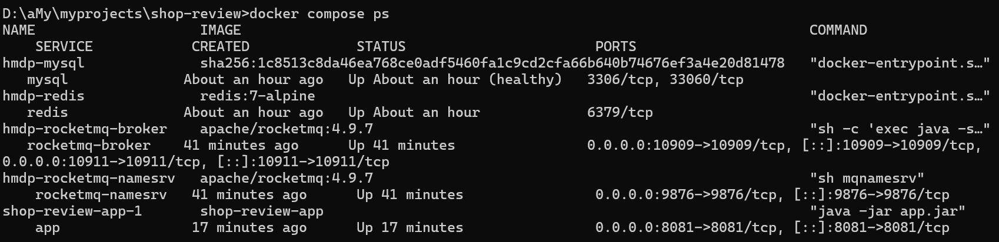

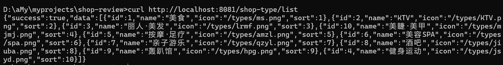

### Postman 登录链路

后续所有需要登录态的测试（秒杀、限流）都依赖一个有效 token。

**Step 1：发送验证码**

- `POST http://localhost:8081/user/code?phone=13800138000` → `{"success": true}`
- 直接读 Redis 取验证码（推荐，key 为 `login:code:{phone}`，TTL 120s）：

```powershell
docker compose exec redis redis-cli -a 840614 --no-auth-warning GET "login:code:13800138000"
```

> 也可从日志取（应用已开 debug 日志）：`docker compose logs app --tail 2`，输出形如 `发送短信验证码成功，手机号：13800138000，验证码：729133`。

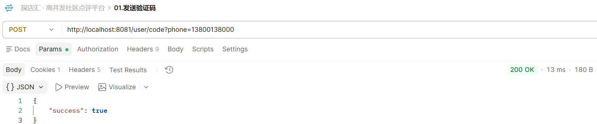

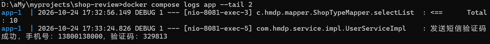

**Step 2：登录**

- `POST http://localhost:8081/user/login`，Body → raw → JSON：`{"phone": "13800138000", "code": "<Step 1 取到的验证码>"}`
- 响应 `data` 字段即 token，复制保存（TTL 30 分钟，过期需重新登录）

> 📷 登录响应（含 token）

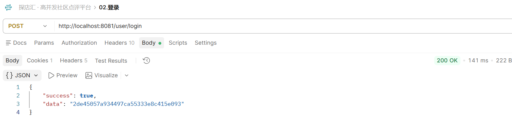

**Step 3：携带 token 访问受保护接口**

- `GET http://localhost:8081/user/me`，Headers 加 `authorization = <token>`

> 📷 `/user/me` 携带 token 的响应

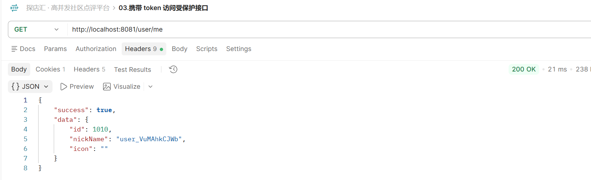

### 持续集成

`.github/workflows/ci.yml` 定义了 `mvn compile` → `mvn -DskipTests package` → `docker build` 三段流水线，用于校验代码与镜像可构建（先 compile 再 package 便于快速失败）。当前仓库托管在 Gitee、未接入远端 Runner，工作流文件保留以便迁移 GitHub 或接入 Gitee Go。

### 常见问题

| 问题 | 原因 | 解决方案 |
|------|------|----------|
| 启动报连不上 NameServer | RocketMQ 未启动 | `docker compose up -d rocketmq-namesrv rocketmq-broker` |
| 秒杀返回"库存不足" | 只预热了 Redis，DB 库存为 0 / 券记录缺失 | 用 `bash scripts/reset-seckill.sh 1 100` 同时重置两边 |
| 接口 401 | 未携带有效 token | 走「Postman 登录链路」获取 token，加 `authorization` 头 |

---

## 📊 性能测试

压测脚本与 JMeter 计划见 [`jmeter/`](jmeter/)，数据复位与登录态预置见 [`scripts/`](scripts/)（Windows 用 Git Bash 执行）。

### 准备工作（每个场景开始前执行一次）

```bash
# 1. 预置 5000 个压测用户登录态（写 Redis + 生成 jmeter/tokens.csv）
bash scripts/gen-loadtest-tokens.sh 5000

# 2. 复位秒杀数据（券 1，库存 100：DB + Redis + 清订单/日志）
bash scripts/reset-seckill.sh 1 100
```

> token TTL 为 **2 小时**，超时后压测会全部返回未登录，重跑第 1 步即可（会覆盖并重置 TTL）。

> 📷 两个脚本执行输出（token 预置 + 数据复位）

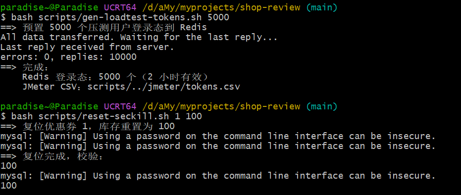

### 结果汇总

| 场景 | 验证点 | 关键结果 |
|------|--------|----------|
| T1 秒杀基线 | 吞吐 / 不超卖 | 535 /s，P99 2443 ms，订单 100、库存 0 |
| T2 接口限流 | 超限拦截 | 30 次 / 2.9s，第 11、25、30 次 429 |
| T3 消息可靠性 | 宕机不丢单 | 停 app 30s，恢复后订单补齐 100 |
| T4 消费并行化 | 线程数收益 | 10/20 线程 37s vs 5/5 线程 34s（受 DB 行锁限制） |
| T5 缓存一致性 | 延迟双删 | 写后 1 秒内读到新值，错误率 0 |
| T6 多级缓存 | Redis 卸载 | Redis QPS ~6600 → ~0 |
| T7 死信链路 | 重试 / 死信 / 对账 | retry=3、DLQ 有消息、对账告警 |

---

### T1 秒杀基线压测

**【测试目的】** 验证高并发秒杀下的吞吐能力与数据正确性：5000 并发抢 100 张券，不超卖、不重复下单。

**【业务场景】** 秒杀开售瞬间，5000 个用户同时抢购同一张限量 100 张的优惠券。

**【测试方案】**

① Postman 先手动打一发确认链路通：`POST http://localhost:8081/voucher-order/seckill/1`，Headers 带 `authorization`，响应 `{"success": true, "data": 订单ID}`

② JMeter CLI 压测（GUI 仅用于调试脚本，出数据用 CLI）：

```bash
jmeter -n -t jmeter/seckill.jmx -Jusers=5000 -JrampUp=10 \
  -JvoucherId=1 -Jhost=localhost -Jport=8081 \
  -l result.jtl -e -o report
```

③ 结果校验：

```powershell
docker compose exec mysql mysql -uroot -p840614 hmdp -N -e `
  "SELECT COUNT(*) FROM tb_voucher_order WHERE voucher_id=1;"          # 期望 100
docker compose exec redis redis-cli -a 840614 --no-auth-warning GET seckill:stock:1   # 期望 0
```

**【执行截图】**

> 📷 Postman 秒杀成功响应（链路验证）

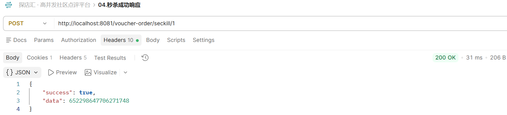

> 📷 JMeter CLI 执行现场（5000 样本、0 错误）与 HTML 报告 Statistics 概览

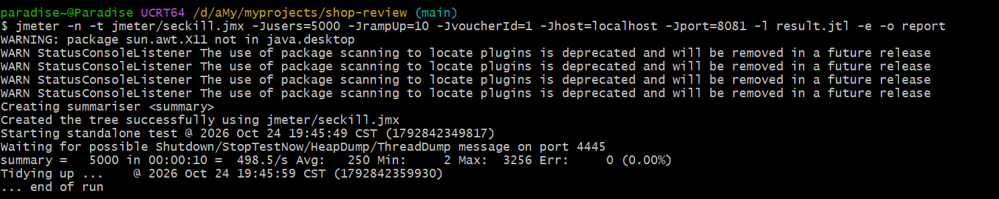

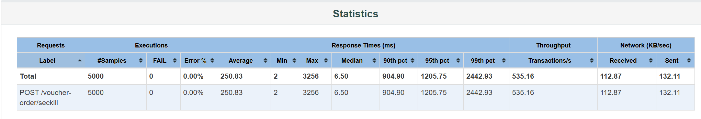

> 两张为两次独立执行，CLI 现场 498.5 /s、报告 535.2 /s，表中数据取自 HTML 报告。

> 📷 订单数 = 100、Redis 库存 = 0 的校验结果

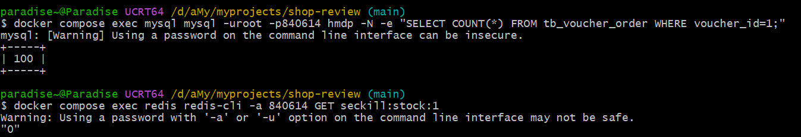

**【结果说明】**

- **实测数据**：5000 并发、rampUp 10s → 吞吐 **535 /s**、P99 **2443 ms**、错误率 **0%**
- **截图证明**：订单数恰好 100、Redis 库存恰好 0
- **结论**：Lua 原子预扣 + `uk_user_voucher` 唯一索引 + 消息幂等三层防护生效，5000 并发下**不超卖、无重复下单**

---

### T2 接口限流

**【测试目的】** 验证滑动窗口限流生效：同一用户 1 秒最多 10 次，超限返回 429。

**【业务场景】** 秒杀期间遭遇脚本/黄牛高频刷单，需在入口就把过量请求挡掉，保护下游 Redis 与 DB。

**【测试方案】** Postman Collection Runner 模拟高频请求：

① 新建 Collection，添加 `POST http://localhost:8081/voucher-order/seckill/1`（Headers 带 `authorization`）

② Collection → Run → **Iterations 填 30、Delay 填 0 ms**

> 30 次 = 3 倍阈值，确保限流被多次触发；Delay 0 ms 制造突发。Runner 单次迭代约 100ms 开销，实际速率 ~10 次/秒，正好压在阈值附近。

③ 预期：阈值 10 次/秒，任意窗口额度用完后继续请求即返回 `429`（响应头带 `Retry-After`）。注意限流**不是"超阈值就全拦"**，只拦超出当前窗口额度的部分：Runner 实际速率 ~10.3 次/秒、仅比阈值高 3%，因此每个窗口只拦 0~1 次

**【执行截图】**

> 📷 Collection Runner 结果（200 与 429 混合出现）

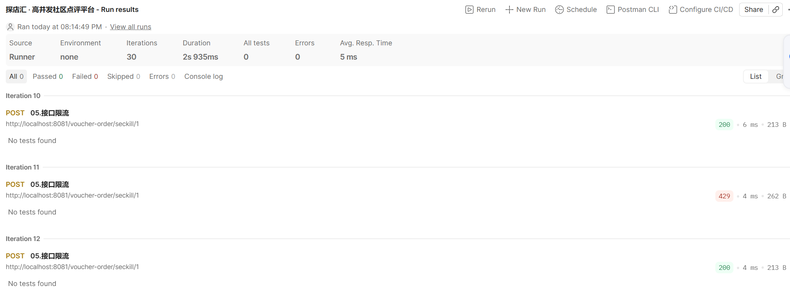

**【结果说明】**

- **实测数据**：30 次迭代 2.9s 完成（≈10 次/秒），其中 **3 次返回 429**（第 11、25、30 次），其余 200
- **截图证明**：200 与 429 交错出现，而非"前 10 次全过、之后全拦"
- **结论**：交错形态正是**滑动窗口**的特征（固定窗口才会一刀切）；计数存 Redis，多实例共享同一阈值

---

### T3 消息可靠性

**【测试目的】** 验证消费者宕机时秒杀消息不丢：事务消息 + 堆积重投 + 幂等消费。

**【业务场景】** 秒杀高峰期实例宕机或滚动发布，已下单消息积压在 Broker，实例恢复后必须全部补消费。

**【测试方案】** 压测进行中停掉 app 制造故障，30 秒后恢复：

```bash
# 1. 复位数据
bash scripts/reset-seckill.sh 1 100

# 2. 后台跑压测（& 放后台，不阻塞终端）
jmeter -n -t jmeter/seckill.jmx -Jusers=5000 -JrampUp=10 \
  -JvoucherId=1 -Jhost=localhost -Jport=8081 -l result.jtl &

# 3. 等 5 秒（压测进行中，消息正在往 MQ 灌）
sleep 5

# 4. 停 app（消费者挂掉，消息堆积在 Broker）
docker compose stop app

# 5. 等 30 秒后恢复
sleep 30
docker compose start app

# 6. 等消费者消化完，轮询订单数
sleep 10
docker compose exec mysql mysql -uroot -p840614 hmdp -N -e \
  "SELECT COUNT(*) FROM tb_voucher_order WHERE voucher_id=1;"
```

**【执行截图】**

> 📷 停/启容器后的最终订单数（=100）

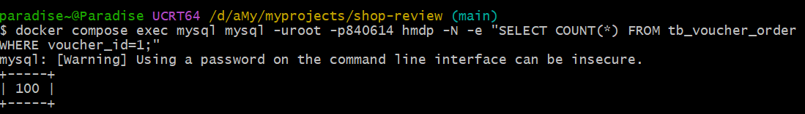

**【结果说明】**

- **实测数据**：停 app 30 秒后恢复，订单数最终补齐至 **100**
- **截图证明**：`COUNT(*) = 100`，一条不少
- **结论**：宕机期间消息全部积压在 Broker 并在恢复后重投；配合消费端幂等（唯一索引 + 消息日志），重复投递不会产生重复订单

---

### T4 消费并行化

**【测试目的】** 对比不同消费线程数下的消息排空耗时，验证消费并行化的实际效果与适用边界。

**【业务场景】** 大促期间 MQ 消息大量堆积，调大消费线程数是最直观的扩容手段。

**【测试方案】** 两轮压测，仅改变消费线程数（10/20 vs 5/5），其余条件一致：

```bash
# 每轮改 docker-compose.yml 后重启，并确认配置已生效
#   SECKILL_CONSUMER_THREADMIN / THREADMAX：第一轮 10/20，第二轮 5/5
#   RATE_LIMIT_ENABLED: "false"（排除限流干扰，测完恢复 true）
docker compose up -d app
docker compose logs app | grep threadMax

# 复位库存（设大库存，确保 5000 请求全部下单）后自动压测 + 计时
bash scripts/reset-seckill.sh 1 10000
bash scripts/measure-drain.sh
```

> `measure-drain.sh` 内部用 rampUp=20（≈250/s 灌入，超过 5 线程消费能力以制造堆积），JMeter 结束后以 Redis 实际下单数为目标，输出排空总耗时。

**【执行截图】**

> 📷 两轮排空耗时对比（脚本输出总耗时 + app 日志 `threadMin/threadMax`）

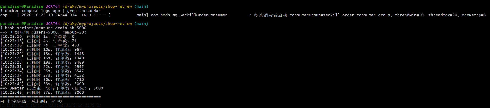

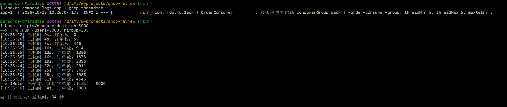

**【结果说明】**

| 轮次 | thread-min / max | 排空耗时 | 平均消费速率 |
|---|---|---|---|
| 第一轮 | 10 / 20 | **37 s** | ~135 /s |
| 第二轮 | 5 / 5 | **34 s** | ~147 /s |

- **实测数据**：5000 请求、rampUp 20s、单热点券；两轮耗时接近（37s / 34s，差异在噪声范围）
- **截图证明**：配置确为 10/20 与 5/5（日志可见），排空耗时 37s / 34s
- **结论**：单热点券下提高线程数**无收益**——每条消息都执行 `UPDATE tb_seckill_voucher SET stock=stock-1 WHERE voucher_id=1`，5000 事务竞争同一行，DB 行锁把写入串行化。并行化的收益体现在**多券种/多队列**场景（行锁分散）；单热点券的进一步优化方向是库存分桶或异步批量扣减

---

### T5 缓存一致性

**【测试目的】** 验证延迟双删下，高并发读进行中发生写操作时缓存与 DB 能快速一致、无长时间脏读。

**【业务场景】** 店铺详情页被高频访问（数据在 Caffeine + Redis 中），此时商家修改店名，要求用户端尽快看到新值。

**【测试方案】** 读写交叉：

① 并发读（CLI）：`GET /shop/1`，500 线程持续 90s

```bash
jmeter -n -t jmeter/shop-read.jmx -Jusers=500 -JrampUp=5 -Jduration=90 -l t5.jtl
```

② 穿插写（Postman）：压测中途发送 `PUT http://localhost:8081/shop`，Body 用完整店铺 JSON 仅改 `name`（字段不全会把其他字段刷成 null）

③ 校验：写请求发出后 1 秒内，`GET /shop/1` 应返回新名称；压测错误率为 0

**【执行截图】**

> 📷 PUT 更新请求 → GET 新名称响应 → 终端轮询输出（`name` 从旧值切换为新值）

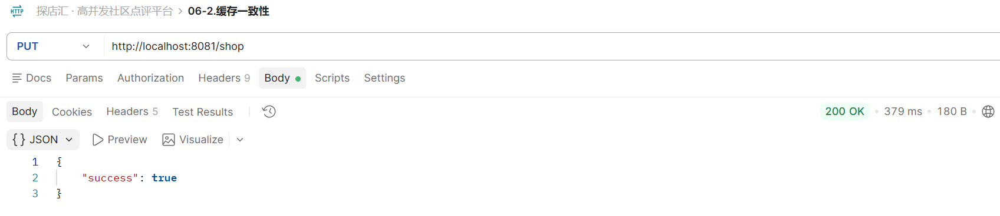

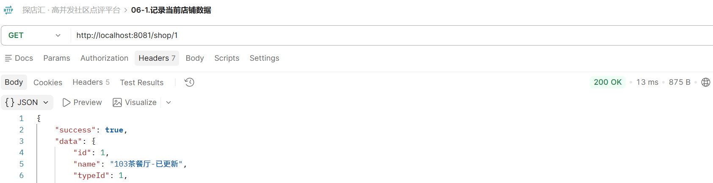

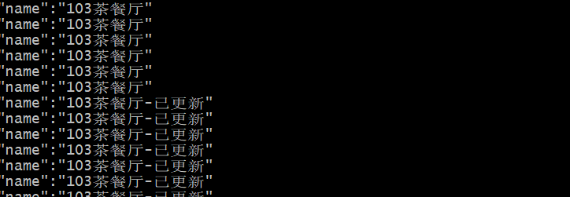

**【结果说明】**

- **实测数据**：500 线程持续读 90s，中途执行改名；写后 **1 秒内** GET 返回新名称，压测错误率 0
- **截图证明**：PUT 成功响应后 GET 立即返回新名称，终端轮询输出可见 `name` 由旧值切换为新值
- **结论**：延迟双删（更新 DB → 事务提交后删缓存 → 500ms 再删）有效封堵了"读线程读到旧值、删缓存后又回填"的脏读窗口，高并发读写交叉下快速收敛一致

---

### T6 热点 Key 多级缓存

**【测试目的】** 对比开/关 L1（Caffeine）时热点 Key 的 Redis QPS 与 JMeter P99，验证多级缓存的流量卸载效果。

**【业务场景】** 首页/详情页等热点数据被全站高频访问，请求全打到 Redis 会压垮单节点，需要进程内缓存就地消化。

**【测试方案】** 两轮压测，仅改变 L1 开关：

① 关闭 L1 基线：`application.yaml` 中 `shop.local-cache.max-size: 0` → `docker compose up -d --build app`

② 预热后压测：先 `curl http://localhost:8081/shop/1` 两次（第一次填 Redis，第二次填 L1），再跑 `GET /shop/1` 500 线程 60s；压测中采样 Redis QPS：

```powershell
docker compose exec redis redis-cli -a 840614 --no-auth-warning info stats | Select-String "instantaneous_ops_per_sec"
```

③ 开启 L1：恢复 `max-size: 1000` 重新 build，重复①②

**【执行截图】**

> 📷 关闭 L1（P99 67ms）与开启 L1（P99 64ms）的 JMeter 报告对比

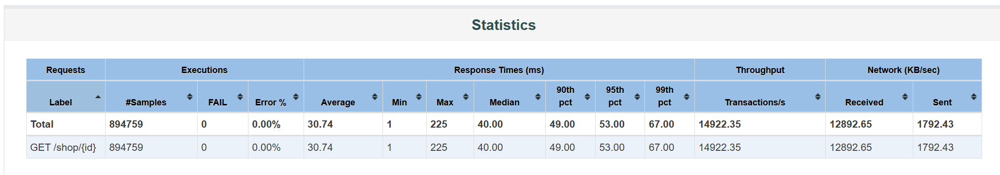

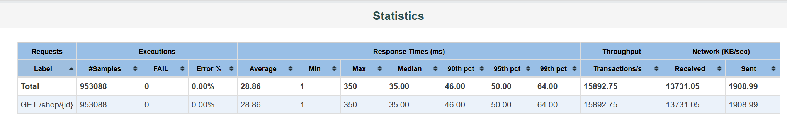

> 📷 关闭 L1 时 Redis QPS ~6600，开启 L1 后归零

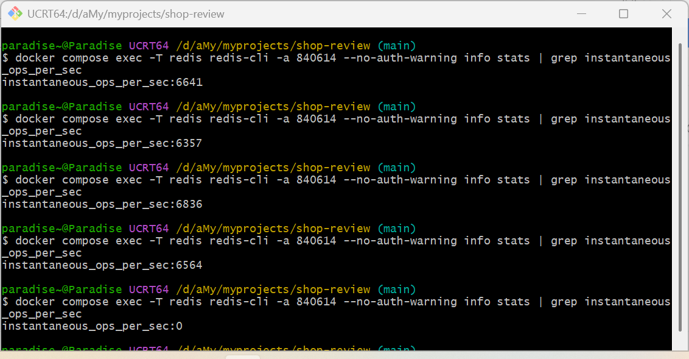

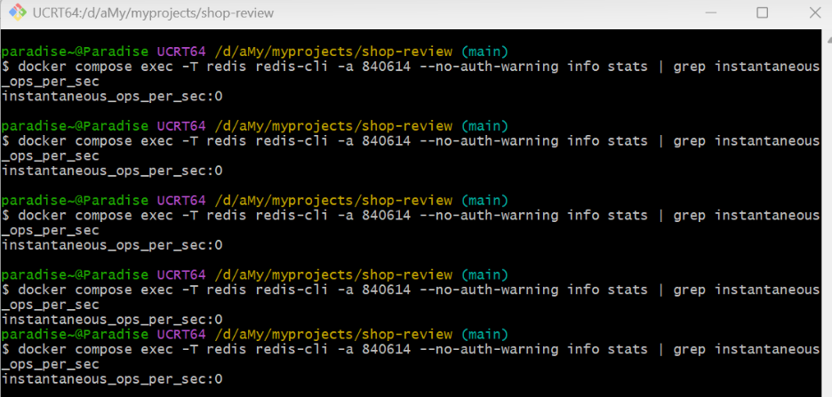

**【结果说明】**

| 轮次 | L1 | 样本数 | 平均响应 | P99 | 吞吐量 | Redis QPS |
|---|---|---|---|---|---|---|
| 第一轮 | 关（max-size=0） | 894759 | 30.74 ms | 67 ms | 14922 /s | ~6600 |
| 第二轮 | 开（max-size=1000） | 953088 | 28.86 ms | 64 ms | 15892 /s | **~0** |

- **实测数据**：Redis QPS 从 ~6600 降至 **~0**；P99 67 → 64 ms（-4.5%）；吞吐 +6.5%
- **截图证明**：开启 L1 后 Redis `instantaneous_ops_per_sec` 归零
- **结论**：热点 Key 读流量被 Caffeine **100% 吸收在进程内**，Redis 完全卸载——这才是多级缓存的核心价值（保护 Redis、支撑多实例扩展）。P99 提升有限是因为单次 Redis GET 本身 <1ms，30ms 延迟的大头在 Tomcat 线程与 HTTP 序列化：**本地缓存优化的是流量，不是延迟**

---

### T7 死信链路

**【测试目的】** 验证消费失败兜底链路完整：重试上限 → 死信队列 → 消息日志落库 → 对账告警。

**【业务场景】** 订单落库后的下游业务（下单通知、加积分）持续失败，消息不能无限重试阻塞消费，必须隔离到死信等待人工补偿。

**【测试方案】**

① 开启失败模拟：`docker-compose.yml` 的 app 环境变量设 `SECKILL_CONSUMER_SIMULATEFAIL: "true"` → `docker compose up -d app`

② Postman 秒杀一单（同 T1 ①），观察日志：

```powershell
docker compose logs -f app | Select-String "消费失败|死信"
# 预期：第 1/3 次 → 第 2/3 次 → 第 3/3 次 → 已转入死信
```

> `simulate-fail` 模拟的是**订单落库成功后的下游业务失败**（`doBusiness()` 扩展点），不是下单失败。因此核心事务正常提交：**订单落库、DB/Redis 库存同步扣减且一致**，失败的只是下游动作，进死信等人工补偿，不回滚订单。

③ 校验：

```powershell
docker compose exec mysql mysql -uroot -p840614 hmdp -N -e `
  "SELECT order_id, status, retry_count FROM tb_seckill_message_log;"   # status=2, retry_count=3
docker compose exec rocketmq-broker sh mqadmin printMsg `
  -t seckill-order-dlq-topic -n rocketmq-namesrv:9876                   # 死信消息
docker compose logs app --since 10m | Select-String "对账"              # 对账告警（5 分钟一次）
```

④ 还原：`SECKILL_CONSUMER_SIMULATEFAIL: "false"` → `docker compose up -d app`

**【执行截图】**

> 📷 重试 3 次转死信的日志

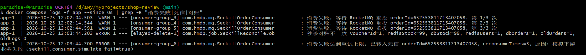

> 📷 Postman 秒杀一单（接口返回订单 ID，订单已落库）

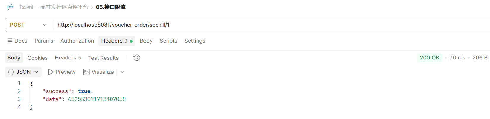

> 📷 message_log `status=2`、死信 Topic 消息、对账告警

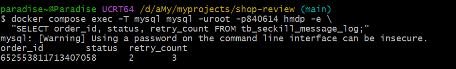

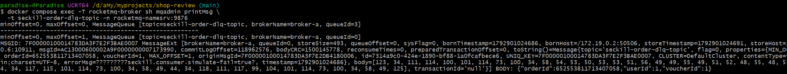

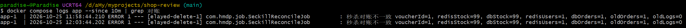

**【结果说明】**

| 证据 | 截图内容 | 证明点 |
|---|---|---|
| 重试日志 | 第 1/3 → 2/3 → 3/3 次 → 已转入死信 | 重试严格受限，**不无限重试阻塞消费** |
| `tb_seckill_message_log` | `status=2, retry_count=3` | 消费轨迹全程落库可查 |
| 死信 Topic | printMsg 出该 orderId 的消息 | 失败消息隔离，可人工补偿 |
| 订单表 + 库存 | 订单落库，DB/Redis 库存各 -1 且一致 | 下游失败不影响核心事务一致性 |
| 对账告警 | ERROR：`oldOrders=1, oldLogs=0` | 有订单但无消费成功日志，对账任务（只告警不改数据）精准定位死信消息 |

**结论**：失败消息「重试 3 次 → 隔离死信 → 全程可查 → 对账兜底告警」闭环成立，既不丢消息，也不会因坏消息拖垮正常消费。
