# ShopHub・店汇通 端到端自动化测试用例

> 以下截图均来自 Apifox / Postman Collection Runner 执行结果，覆盖秒杀→支付→核销主链路及所有异常分支。

---

## 一、秒杀 → 支付 → 核销 全链路

正常用户从秒杀下单到核销的完整路径验证。

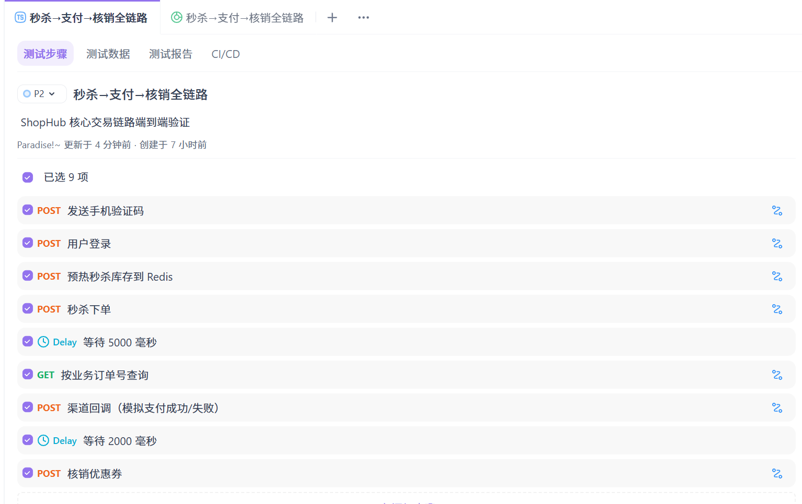

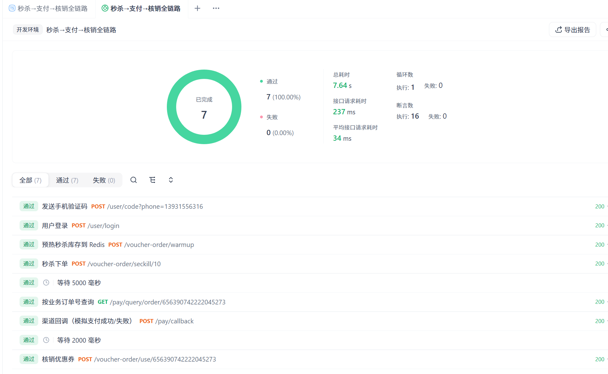

---

## 二、取消订单 → 库存回补 全链路

用户主动取消未支付订单，验证 shop-pay FAILED + shop-seckill 订单 1→4 + **DB+Redis 双重库存回补**。

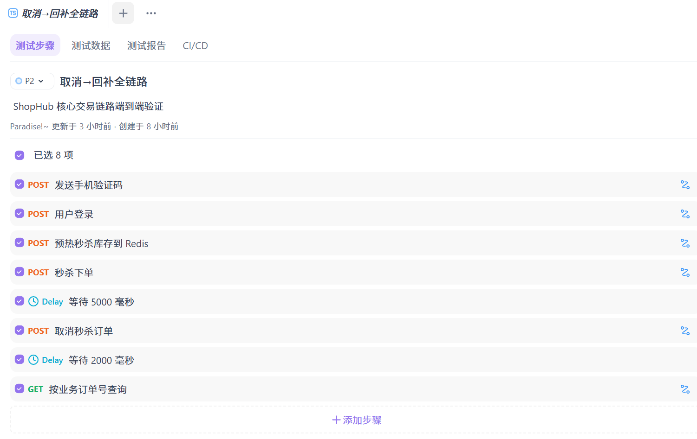

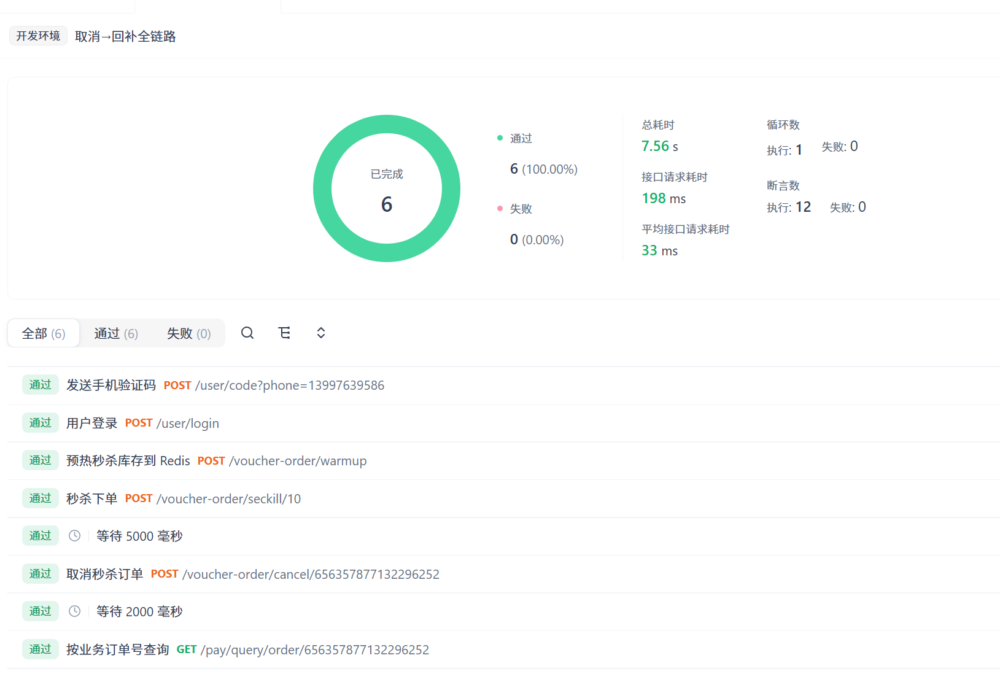

---

## 三、退款 全链路

已支付订单退款，验证 shop-pay PAID→REFUNDED + shop-seckill 订单 2→4 + 库存回补给下一次秒杀。

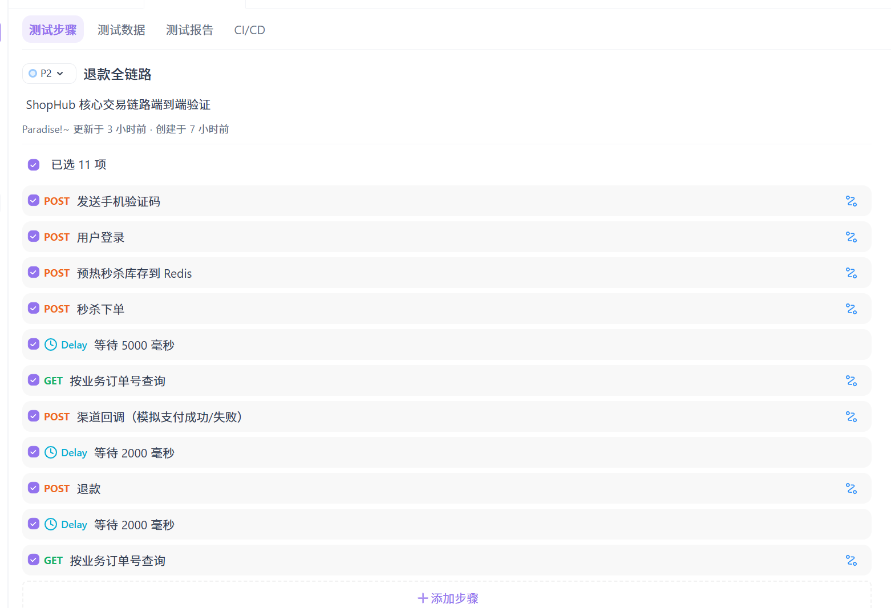

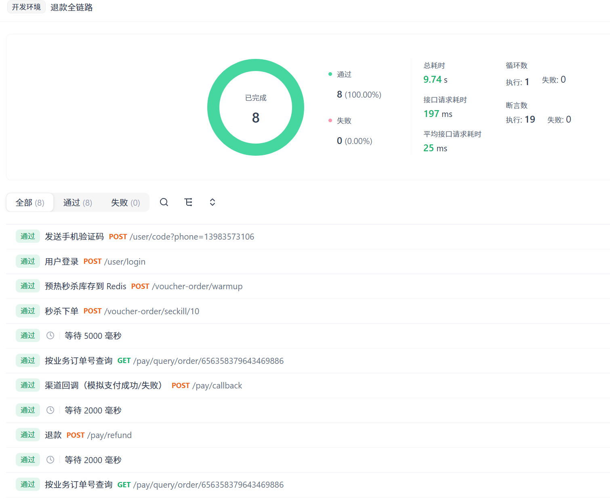

---

## 四、幂等性验证

同一消息被 RocketMQ 重投消费时，`tb_seckill_message_log.uk_order_id` 唯一索引保证不重复落单；同一渠道回调 SHA256 不重复处理。

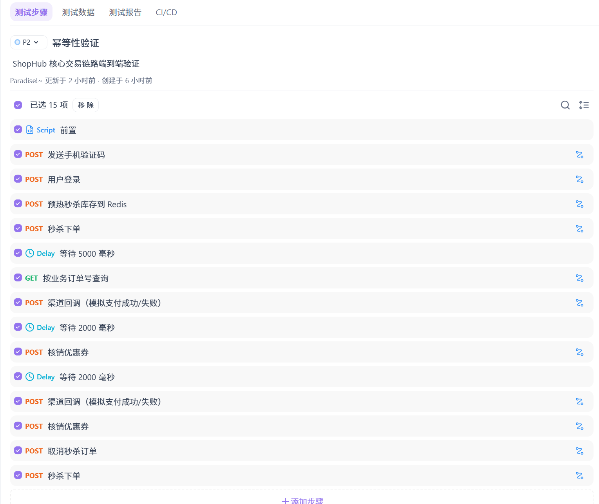

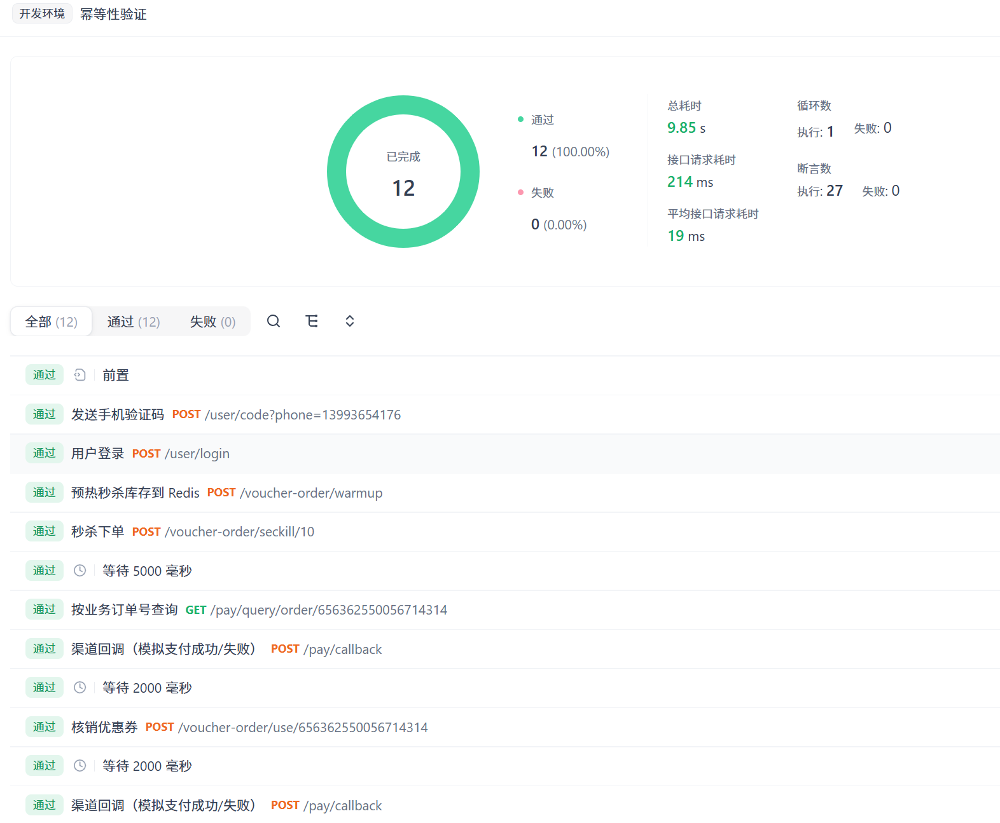

---

## 五、支付过期关单验证

`PayExpireJob` 定时扫描 `status=0` 且 `expire_time < NOW()` 的支付单 → FAILED + Outbox 发 PAY_FAIL → shop-seckill 订单自动取消 + 库存回补。

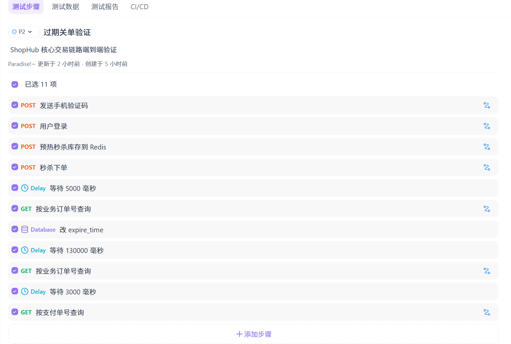

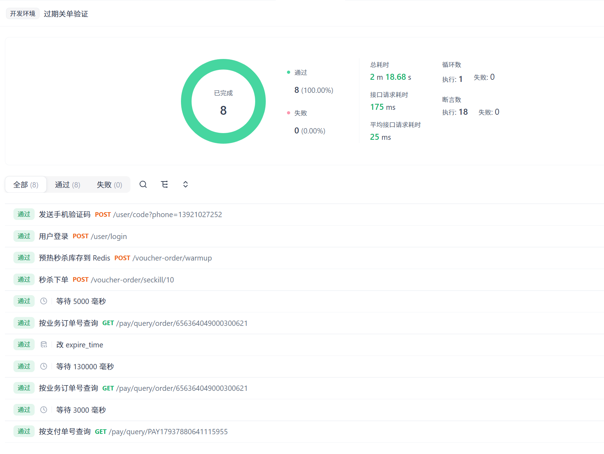

---

## 六、库存耗尽拦截（超卖防护验证）

Redis Lua + DB `stock>0` 双重保证，5000 并发抢 100 张券 → 恰好 100 单，不超卖不重复。

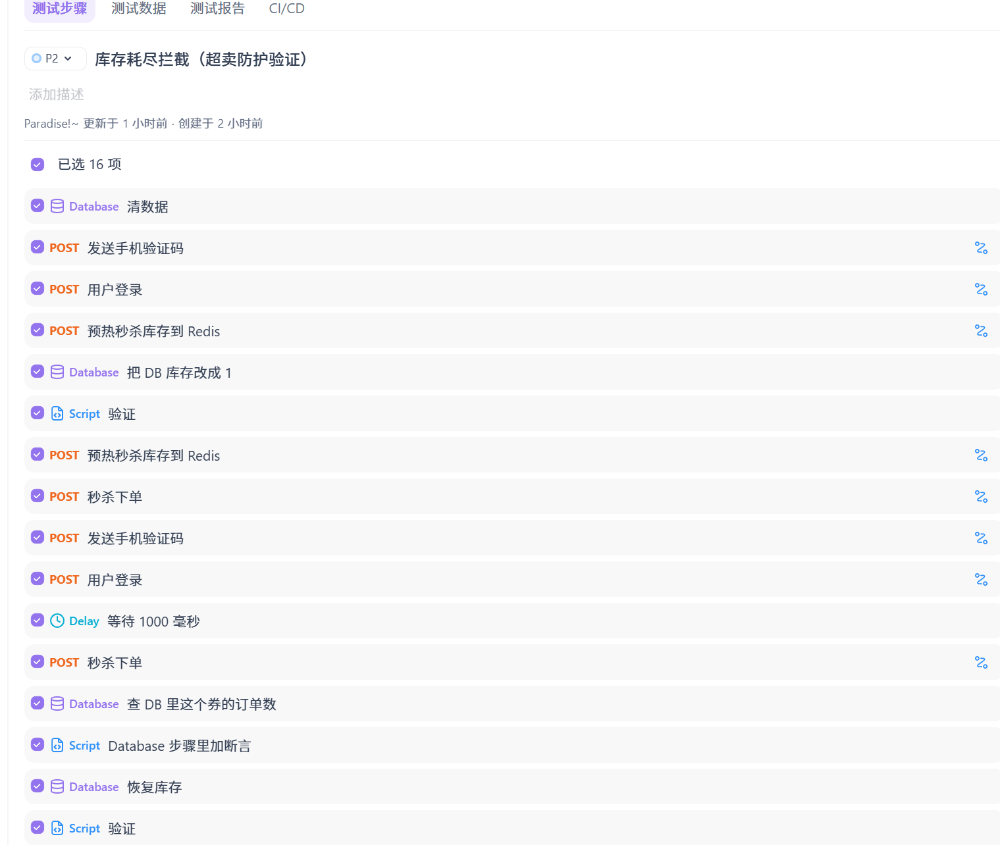

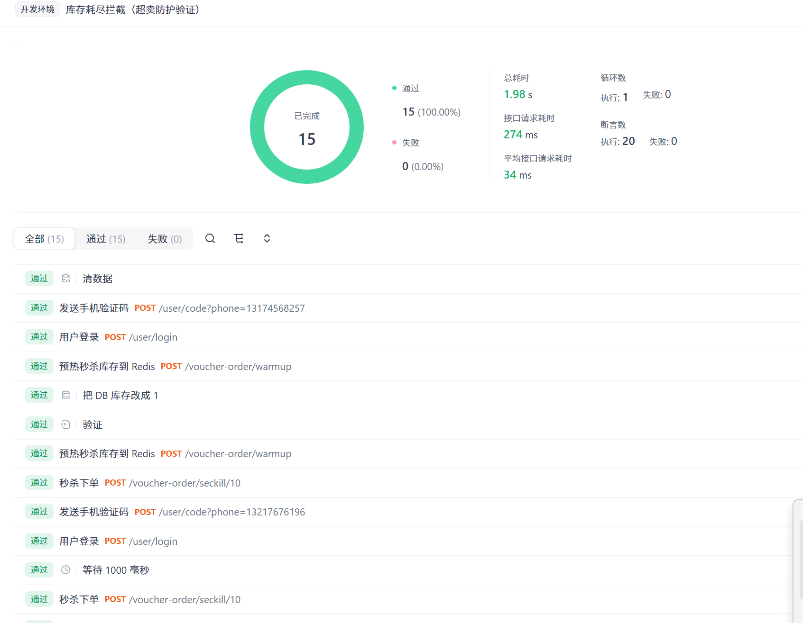
