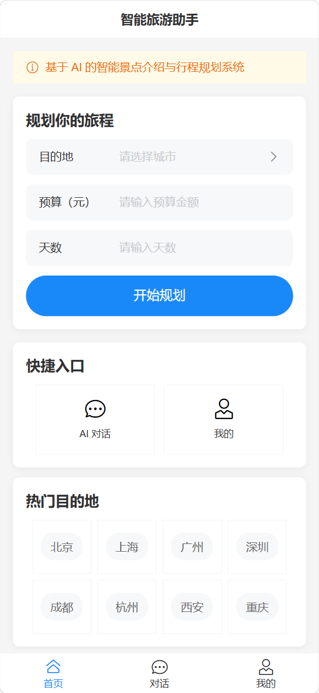
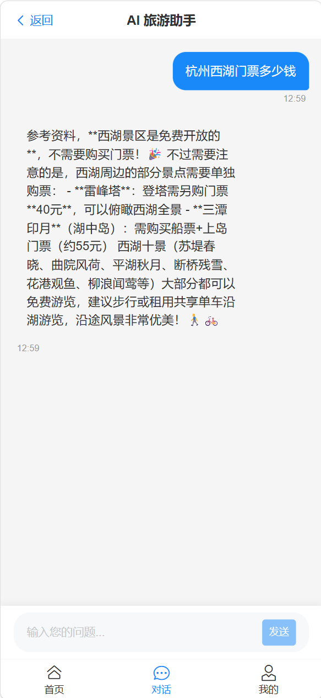
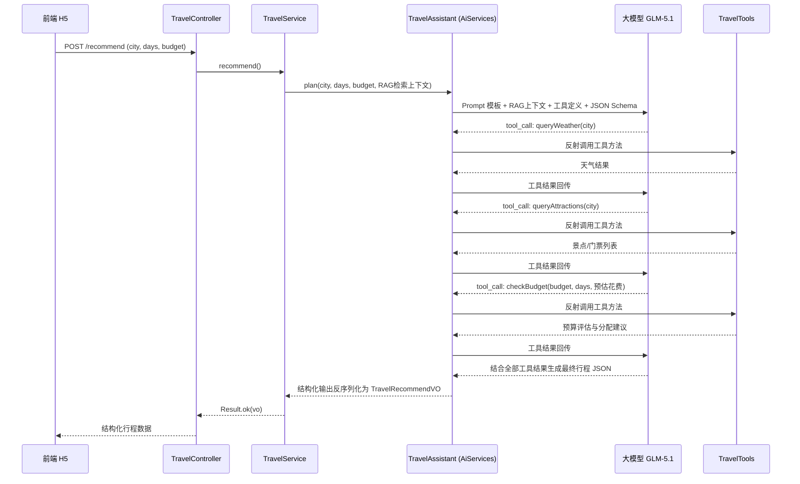
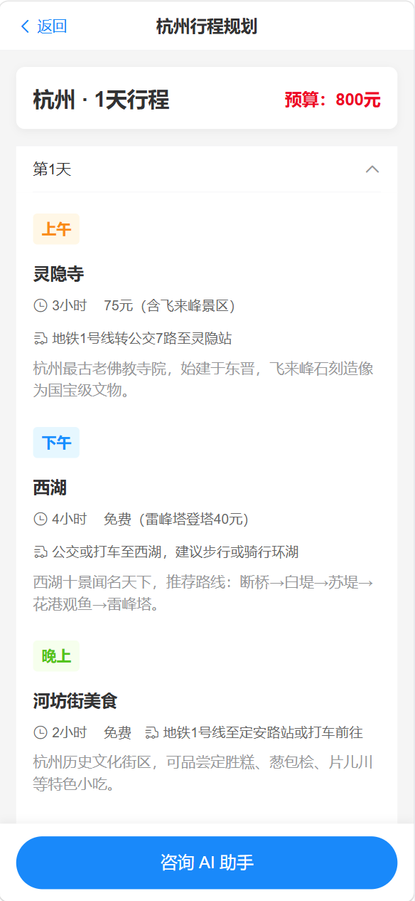
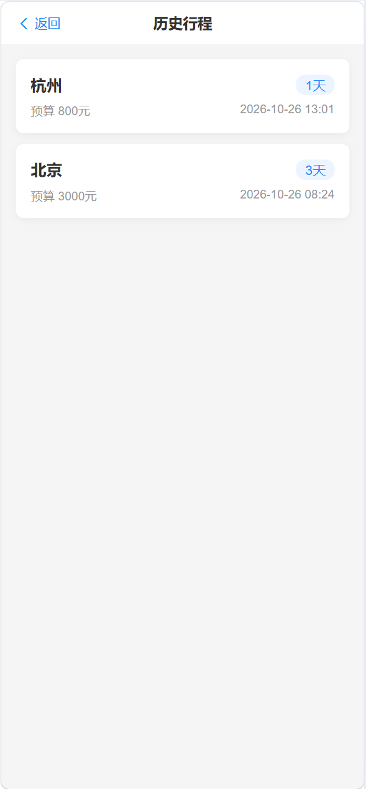
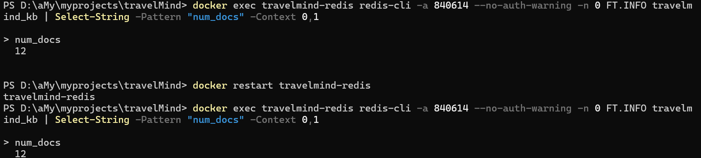
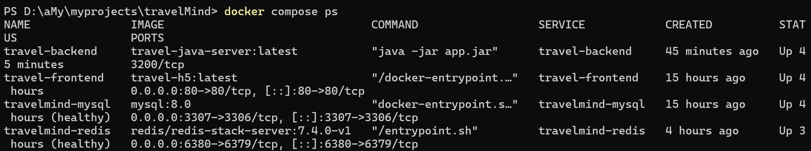

# TravelMind 智旅平台

> 基于 **Spring Boot 3 + LangChain4j + Vue 3** 的全栈移动端旅游规划平台。支持智能行程推荐（Function Calling 多步推理）与 AI 旅游问答（SSE 流式 + 会话记忆 + RAG 知识库增强），内置账号体系、限流熔断与可观测能力，Docker 一键部署。

---

## 📋 项目简介

TravelMind 智旅平台是一款 AI 驱动的移动端旅游规划 H5 应用。用户注册登录后，输入目的地、预算和旅行天数，系统由大模型自主调用工具链生成结构化行程并自动落库；同时提供带多轮记忆的 AI 旅游问答，边生成边显示。

| 首页（行程规划表单） | AI 对话（流式回复） |
|:---:|:---:|
|  |  |

**项目亮点：**

- 🤖 **Function Calling 工具链**：大模型自主决策调用 天气 → 景点 → 预算 本地工具，多步推理生成行程
- 🧩 **LangChain4j 编排**：AiServices 声明式接口 + 结构化输出（JSON Schema 自动注入/反序列化），Prompt 外置
- 📚 **RAG 知识库增强**：bge-m3 向量化 + RediSearch 持久化检索，按城市元数据过滤，多轮对话查询改写，回答附引用来源
- 💬 **流式对话 + 会话记忆**：SSE 打字机效果，Redis 按 sessionId 隔离多轮上下文（窗口 20 条）
- 🔐 **账号体系**：注册/登录 + JWT 鉴权，行程按用户落库 MySQL，支持历史行程回看
- 🛡 **稳定性三板斧**：Redis ZSet + Lua 滑动窗口限流、Resilience4j 熔断降级、Micrometer → Prometheus 指标打点
- 🐳 **一键部署**：docker compose 编排 前端 Nginx + 后端 + Redis + MySQL 四容器

---

## 🛠 技术栈

### 后端

| 分类 | 技术 | 版本 | 说明 |
|------|------|------|------|
| 开发语言 | Java | 17 | LTS 版本 |
| 后端框架 | Spring Boot | 3.5.0 | spring-boot-starter-web |
| 大模型编排 | LangChain4j | 1.0.0-beta1 | AiServices / Function Calling / TokenStream / ChatMemory |
| 大模型 API | 硅基流动 GLM-5.1 | - | OpenAI 兼容格式 |
| Embedding 模型 | 硅基流动 BAAI/bge-m3 | - | RAG 文档向量化，1024 维 |
| 数据库 | MySQL | 8.0 | 用户表 + 行程表 |
| ORM | MyBatis-Plus | - | BaseMapper + LambdaQueryWrapper |
| 缓存/限流/向量库 | Redis Stack | 7.4 | db 1：会话记忆 + ZSet 滑动窗口限流（Lua）；db 0：RediSearch 向量索引（RAG 持久化） |
| 熔断降级 | Resilience4j | - | LLM 调用熔断保护 |
| 认证 | JJWT | - | HS256，有效期 7 天 |
| 参数校验 | Spring Validation | - | `@Valid` + 注解校验 |
| 指标监控 | Micrometer + Prometheus | - | LLM 调用次数/耗时/Token 用量 |
| 构建工具 | Maven | - | 依赖管理与构建 |

### 前端

| 分类 | 技术 | 版本 | 说明 |
|------|------|------|------|
| 前端框架 | Vue | 3.5 | Composition API |
| UI 组件库 | Vant | 4.9 | 移动端 UI 库 |
| 路由 | Vue Router | 4.3 | 含全局登录守卫 |
| 状态管理 | Pinia | 4.1 | 登录态（token/username），localStorage 持久化 |
| HTTP 请求 | Axios + Fetch API | - | 普通请求用 Axios，SSE 流式用 Fetch |
| 构建工具 | Vite | 8 | 极速开发构建 |

---

## 🏗 项目架构

### 整体架构

```
┌─────────────┐  HTTP/SSE   ┌──────────────┐  HTTP   ┌──────────────┐
│ 前端 H5     │ ───────────▶│ Spring Boot  │ ───────▶│  大模型 API  │
│ Vue3 + Vant │ ◀───────────│  后端服务    │ ◀───────│  硅基流动    │
└─────────────┘             └──────┬───────┘         └──────────────┘
                                   │
                    ┌──────────────┼──────────────┐
                    ▼              ▼              ▼
              ┌──────────┐  ┌──────────┐   ┌───────────┐
              │  MySQL   │  │  Redis   │   │ Prometheus │
              │ 用户/行程 │  │记忆/限流/│   │  指标采集  │
              └──────────┘  │ 向量检索  │   └───────────┘
                            └──────────┘
```

### 后端分层结构

```
travel-java/src/main/java/org/example/traveljavaserver/
├── controller/
│   ├── TravelController.java        # 行程规划 / AI 对话 / 历史行程 / 健康检查
│   └── AuthController.java          # 注册 / 登录（签发 JWT）
├── service/
│   ├── TravelService.java           # 行程业务（LLM 调用 + 熔断 + 落库 + 历史查询）
│   └── AuthService.java             # 注册登录（BCrypt 密码加密）
├── langchain/
│   ├── TravelAssistant.java         # LangChain4j AiServices 声明式接口
│   ├── LangChainConfig.java         # 模型 Bean 构建（含指标监听器、记忆配置、向量库、查询改写器）
│   ├── KnowledgeBaseInitializer.java# 知识库初始化：docs/*.md 切块 → 向量化 → 入库（含 city 元数据）
│   └── RedisChatMemoryStore.java    # 自定义 Redis 会话记忆存储
├── tools/
│   └── TravelTools.java             # @Tool 工具：天气/景点/预算校验
├── ratelimit/
│   └── RateLimiter.java             # Redis ZSet + Lua 滑动窗口限流
├── metrics/
│   └── LlmMetricsListener.java      # LLM 调用指标打点（次数/耗时/Token）
├── common/
│   ├── JwtAuthInterceptor.java      # JWT 鉴权拦截器（uid 注入 request）
│   ├── WebMvcConfig.java            # 拦截器注册（/api/travel/**，放行 hello）
│   ├── CorsConfig.java              # CORS 跨域配置
│   └── GlobalExceptionHandler.java  # 全局异常处理
├── utils/
│   └── JwtUtils.java                # JWT 签发/解析
├── entity/ mapper/ dto/ vo/         # 实体 / Mapper / 请求 / 响应封装
└── resources/
    ├── application.yml              # 应用配置（全部支持环境变量覆盖）
    ├── prompts/travel-plan.txt      # 外置 Prompt 模板
    └── docs/*.md                    # RAG 知识库文档（5 城市 + 通用常识）
```

### 前端页面结构

```
travel-h5/src/
├── views/
│   ├── Home.vue          # 首页（城市选择 / 预算 / 天数 / 热门目的地）
│   ├── Detail.vue        # 行程详情页（每日行程 / 预算明细 / 历史模式回放）
│   ├── Chat.vue          # AI 对话页（流式聊天 / sessionId 会话记忆）
│   ├── Login.vue         # 登录 / 注册页
│   ├── History.vue       # 历史行程列表
│   └── Profile.vue       # 个人中心（昵称 / 历史行程入口 / 退出登录）
├── components/
│   ├── ChatBubble.vue    # 聊天气泡组件
│   ├── BudgetTable.vue   # 预算表格组件
│   └── SpotItem.vue      # 景点条目组件
├── store/
│   └── user.js           # Pinia 登录态（token 持久化）
├── router/
│   └── index.js          # 路由 + 全局登录守卫（未登录重定向 /login）
├── utils/
│   └── request.js        # Axios 封装（Token 拦截器 / 401 处理 / SSE fetchStream）
├── App.vue
└── main.js
```

---

## 💡 核心功能与技术亮点

### 1. 智能旅游规划（Function Calling 多步推理）

**接口：** `POST /api/travel/recommend`（需 JWT）

行程规划不再是「一次性 Prompt」，而是由大模型**自主决策、多步调用**本地工具后再生成最终方案。后端通过 LangChain4j `@Tool` 注册三个工具，模型按需在多轮交互中调用：

| 工具 | 方法 | 作用 | 实现方式 |
|------|------|------|----------|
| 天气查询 | `queryWeather(city)` | 获取目的地天气，影响行程安排 | 模拟数据（预留真实天气 API 替换点） |
| 景点查询 | `queryAttractions(city)` | 获取热门景点 / 门票 / 建议时长 | 内置 5 个热门城市数据 |
| 预算校验 | `checkBudget(budget, days, cost)` | 评估预算是否充足并给出分配建议 | 纯逻辑计算（住宿30/餐饮30/交通20/门票15/其他5） |

**多步推理时序图：**



**核心设计：**

- **声明式 AiServices**：`TravelAssistant.plan()` 返回 POJO，LangChain4j 自动把 JSON Schema 注入提示词并将模型回复反序列化为 `TravelRecommendVO`，替代手写正则提取
- **工具自动注册**：`AiServices.builder().tools(travelTools)`，框架自动完成 tool_call 往返，业务代码零感知
- **Prompt 外置**：`prompts/travel-plan.txt` 模板文件，改提示词无需改代码
- **RAG 上下文注入**：规划前按城市检索知识库（景点/门票/美食/交通），检索片段注入 Prompt，门票等事实数据以知识库为准；响应携带 `citations` 引用来源
- **熔断保护**：`@CircuitBreaker(name = "llm")` 包裹 LLM 调用，失败率过高自动熔断走 fallback
- **自动落库**：规划成功后将完整行程 JSON 写入 `tm_travel_plan`（绑定当前用户），供历史行程查询

**效果截图（行程详情页）：**



---

### 2. AI 旅游咨询（SSE 流式 + 会话记忆）

**接口：** `POST /api/travel/chat`，`Content-Type: text/event-stream`（需 JWT）

**完整流程：**

1. 前端使用 `Fetch API` 发起 POST 请求（Axios 不支持流式读取），手动携带 `Authorization: Bearer <token>` 与 `sessionId`
2. 后端返回 `SseEmitter`；Service 层先执行 RAG 检索（命中城市时按元数据过滤），把上下文注入 System Prompt 后调用 `TravelAssistant.chat()` 返回 LangChain4j `TokenStream`
3. TokenStream 回调逐块推送：`onPartialResponse` → 序列化为 `data:{"type":"chunk","content":"..."}` 推给前端
4. 流结束前推送引用来源 `data:{"type":"citations","sources":["hangzhou.md",...]}`，随后发送 `data:{"type":"done"}` 关闭连接；出错发送 `data:{"type":"error","message":"..."}`
5. 前端 `reader.read()` 循环读取流 → 解析 `data:` 行 → 追加内容 → 打字机效果

**会话记忆：**

- 前端首次访问生成 UUID 存入 localStorage 作为 sessionId，每次对话携带
- 后端按 sessionId 从 Redis 加载该会话历史消息（自定义 `RedisChatMemoryStore`），随请求一并发给模型
- 记忆窗口 20 条，超出自动裁剪，控制 Token 成本
- 退出登录清空 sessionId，换号自动开启全新会话

**SSE vs WebSocket 选型：**

| 特性 | SSE | WebSocket |
|------|-----|-----------|
| 协议 | HTTP | 独立协议（ws://） |
| 通信方向 | 服务端 → 客户端（单向） | 全双工（双向） |
| 实现复杂度 | 低，浏览器原生支持 | 高，需协议升级握手 |
| 适用场景 | AI 对话、消息推送、实时日志 | 聊天室、在线协作、游戏 |

> 选型理由：AI 对话本质是服务端流式输出，SSE 足够用；大模型 API 本身就是 SSE 格式输出，后端直接转发更自然。

---

### 3. 账号体系与行程持久化

**接口：** `POST /api/auth/register`、`POST /api/auth/login`、`GET /api/travel/plans`（需 JWT）

- **注册/登录**：用户名 + 密码（BCrypt 加密存储，`tm_user` 表 `uk_username` 唯一索引防重），成功签发 JWT（HS256，7 天有效期）
- **JWT 鉴权**：`JwtAuthInterceptor` 拦截 `/api/travel/**`（放行 hello），解析 Token 将 uid 注入 request；无 Token/过期统一返回 HTTP 401
- **前端配套**：Axios 请求拦截器自动携带 Token；401 统一清登录态并跳登录页（带 redirect 回跳）；路由守卫拦截未登录访问
- **行程落库**：recommend 成功后按 uid 写入 `tm_travel_plan`，历史行程页倒序展示，点击可回放完整规划详情

| 登录页 | 历史行程列表 |
|:---:|:---:|
|  |  |

---

### 4. 稳定性设计

**滑动窗口限流（Redis ZSet + Lua）：**

- 按 `接口:IP` 维度计数，Lua 脚本原子完成 清理过期窗口 → 计数 → 判断
- 默认 60s 窗口单 IP 单接口 10 次，超限返回 429 错误（SSE 接口推送错误帧）
- 多实例共享计数，阈值/窗口/开关均支持环境变量覆盖（`RATE_LIMIT_*`）

**熔断降级（Resilience4j）：**

- LLM 调用包裹 `@CircuitBreaker(name = "llm")`：最近 10 次调用失败率 ≥50% 触发熔断
- 熔断 30s 后自动进入半开试探（3 次许可），避免长时间不可用
- fallback 直接返回友好错误提示，快速失败保护下游模型服务

**可观测（Micrometer + Prometheus）：**

- `LlmMetricsListener` 监听每次模型调用，暴露指标：`llm_call_total`（调用次数）、`llm_latency`（耗时）、`llm_tokens`（输入/输出 Token 用量）
- Actuator 端点：`/actuator/health`、`/actuator/prometheus`

---

### 5. RAG 知识库增强（向量检索 + 来源引用）

**接口：** `POST /api/travel/kb/reload`（需 JWT，知识库热重载）

**检索链路：**

```
用户查询 ──▶ 查询改写（多轮对话时结合会话历史压缩为独立查询，CompressingQueryTransformer）
        ──▶ 城市识别（命中北京/上海/杭州/成都/西安时附加 city 元数据过滤）
        ──▶ RediSearch 向量检索（Top-5，相似度 ≥0.6）
        ──▶ 上下文注入 Prompt ──▶ 模型生成 ──▶ 返回回答 + citations 引用来源
```

**核心设计：**

- **向量化入库**：启动时扫描 `resources/docs/*.md`（北京/上海/杭州/成都/西安 + 通用常识），按 500 字符块、50 重叠递归切块，bge-m3（1024 维）向量化写入 `RedisEmbeddingStore`（索引 `travelmind_kb`，db 0，重启不丢）
- **持久化**：Redis Stack 镜像自带 RediSearch 模块，向量数据落盘（AOF），重启 Redis/后端均无需重算
- **城市过滤**：每个片段携带 `city` 元数据，查询命中已知城市时只召回「该城市 + 通用常识」片段，消除跨城市引用噪声
- **查询改写**：多轮对话中不含城市名的追问（如"那边有什么必吃的美食"），结合 Redis 会话历史压缩改写为独立查询（如"杭州必吃特色美食推荐"），改写失败自动降级为原始查询
- **来源透传**：chat 流末尾推送 `citations` 事件，recommend 响应携带 `citations` 字段（前端展示暂未接入，数据已就绪）
- **热重载**：修改 `docs/*.md` 后调用 `/api/travel/kb/reload` 即可清空重建向量索引，无需重启服务

**RediSearch 向量索引实证（重启容器后数据仍在）：**



---

## 🚀 快速启动

### 方式一：Docker 一键部署（推荐）

无需本地安装 JDK / Maven / Node.js，只需 Docker 环境，一条命令启动全部四个容器。

**部署架构：**

```
浏览器 ──▶ Nginx 容器 (80 端口)
            ├── /            静态页面（Vue3 构建产物）
            └── /api/**  ──▶ Spring Boot 容器 (3200，仅容器网络内可见) ──▶ 大模型 API
                                    │
                                    ├──▶ Redis Stack 容器 (会话记忆/限流 db 1 + RediSearch 向量检索 db 0，宿主机 6380 可调)
                                    └──▶ MySQL 容器 (用户/行程，宿主机 3307 可查)
```

- 前后端同域部署，Nginx 反代 `/api`，天然规避 CORS
- SSE 已在 Nginx 关闭缓冲（`proxy_buffering off`），打字机效果正常
- 后端端口不映射宿主机，仅容器网络内可达；Redis/MySQL 固定端口映射便于排查
- MySQL 首次启动自动执行 `travel-java/docker/mysql/init.sql` 完成建库建表

**步骤：**

```bash
# 1. 项目根目录创建 .env，填入硅基流动 API Key（docker compose 自动读取，勿提交 git）
echo LLM_API_KEY=你的密钥 > .env

# 2. 构建并启动
docker compose up -d --build

# 3. 验证
docker compose ps                        # 四个容器应全部 running/healthy
curl http://localhost/api/travel/hello   # 返回 hello world 即后端正常
```



浏览器打开 `http://localhost`，注册账号后即可体验完整功能。

### 方式二：本地分别启动（开发调试）

**前置依赖：** JDK 17+、Maven、Node.js 18+，以及 Redis Stack（6380，密码 840614，db 0 向量 / db 1 记忆限流）和 MySQL（3307，库 travelmind）——可直接用 compose 单独起基础设施：

```bash
docker compose up -d travelmind-redis travelmind-mysql
```

**后端：**

```bash
cd travel-java
# Windows PowerShell 注入 API Key 后启动
$env:LLM_API_KEY=(Get-Content ..\.env | Where-Object { $_ -match '^LLM_API_KEY=' }).Replace('LLM_API_KEY=','')
.\mvnw.cmd -s settings-aliyun.xml spring-boot:run
# 验证：curl http://localhost:3200/api/travel/hello
```

**前端：**

```bash
cd travel-h5
npm install
npm run dev        # Vite 已配置 /api 代理到 3200
```

浏览器打开 `http://localhost:5173`。

### 环境变量一览

| 变量 | 默认值 | 说明 |
|------|--------|------|
| `LLM_API_KEY` | 无（必填） | 硅基流动 API 密钥 |
| `REDIS_HOST` / `REDIS_PORT` / `REDIS_PASSWORD` | localhost / 6380 / 840614 | Redis Stack 连接（db 0 存向量索引，db 1 存会话记忆/限流） |
| `MYSQL_HOST` / `MYSQL_PORT` / `MYSQL_USER` / `MYSQL_PASSWORD` | localhost / 3307 / root / 840614 | MySQL 连接（库 travelmind） |
| `JWT_SECRET` | 内置开发值 | JWT 签名密钥，生产必须用环境变量覆盖 |
| `RATE_LIMIT_ENABLED` / `RATE_LIMIT_WINDOW_SECONDS` / `RATE_LIMIT_MAX_REQUESTS` | true / 60 / 10 | 限流开关与阈值 |

### 常见问题

| 问题 | 原因 | 解决方法 |
|------|------|----------|
| 拉取镜像超时 | 直连 Docker Hub 网络慢 | 配置 `registry-mirrors` 镜像加速 |
| AI 功能报 401/失败 | API 密钥失效或额度耗尽 | 更新 `.env` 后执行 `docker compose up -d` 重建后端 |
| 修改 `.env` 后不生效 | 环境变量仅在容器创建时注入 | 执行 `docker compose up -d` 重建容器 |
| 接口频繁返回 429 | 触发滑动窗口限流 | 调大 `RATE_LIMIT_MAX_REQUESTS` 或临时关闭 `RATE_LIMIT_ENABLED` |
| 登录后接口仍 401 | JWT_SECRET 变更导致旧 Token 失效 | 重新登录获取新 Token |
| 修改知识库文档后不生效 | 向量索引未重建 | 调用 `POST /api/travel/kb/reload` 热重载（需 JWT） |
| AI 回答引用来源与提问城市不符 | 多轮追问未携带城市名 | 已内置查询改写自动补全；确认后端日志出现 `[RAG] 查询改写` |
